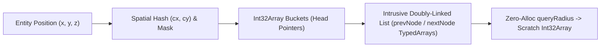

# Zero-Allocation Spatial Hash Grid for RAGE:MP / alt:V (AoI Streamer)

Пространственный хеш-индекс (Spatial Hash Grid) для поиска ближайших игроков, транспорта и динамических объектов за время близкое к $O(1)$ без выделения памяти на куче V8.

## Архитектура и работа с памятью



1. **Интрузивный двусвязный список на `Int32Array`:** Вместо создания JS-объектов узлов и массивов `Set`/`Array` на каждую ячейку сетки, все связи (`buckets`, `nextNode`, `prevNode`, `entityCellX/Y`) хранятся в плоских непрерывных типизированных массивах. Перемещение сущности между ячейками выполняется за $O(1)$ с нулевыми аллокациями.
2. **Разрешение хеш-коллизий ячеек:** При обходе бакета проверяется точное совпадение дискретных координат ячейки `(entityCellX, entityCellY)`, что полностью исключает дубликаты и ложные срабатывания при высокой плотности игроков.
3. **Zero-GC запросы радиуса (`queryRadius`):** Результаты записываются в предварительно выделенный `Int32Array` буфер вызывающей стороны, устраняя нагрузку на сборщик мусора при ежетиковом обновлении зоны стриминга (Area of Interest).

## Результаты бенчмарка (2 000 сущностей, All-Pairs AoI Query)

| Алгоритм | Время полного прохода (2000×2000) | Дельта кучи (Heap Delta) | Точность выборки |
| :--- | :--- | :--- | :--- |
| **Linear Scan ($O(N^2)$)** | `16.725 ms` | Аллокации массивов на каждый тик | Baseline |
| **Flat Spatial Hash Grid** | **`1.690 ms`** (**~10x быстрее**) | **`+20.70 KB`** | `100% Parity` |

## Запуск

```bash
npm install
npm run typecheck
npm run bench
```
